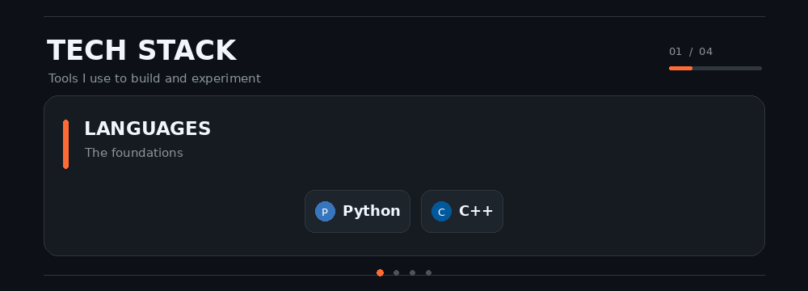

 <!-- HERO -->

 

**Final-year AI undergraduate · Amity University**

Building reliable AI systems that interact with the real world.

---

## About

I'm an AI undergraduate interested in building intelligent systems that go beyond conventional interfaces.

My interests in **computer vision, speech AI tasks, and applied machine learning**.

- Exploring practical applications of AI through research, experimentation, and building.
- Interested in privacy-first and on-device AI systems.
- Building **Restrct** — exploring entrepreneurship alongside engineering.
- Always curious about how AI can solve problems beyond the screen.

---

## Selected Projects

| Project | Description |
|:--|:--|
| [**VisionQ**](https://huggingface.co/spaces/NanG01/visionq) | Local visual AI system combining object detection, OCR, visual embeddings, memory, and retrieval. |
| [**ListenIQ**](https://github.com/Team-Manusmriti/ai-challenge-submission-project-manusmriti) | Privacy-first multimodal AI assistant combining vision, audio, and contextual memory. Designed and developed the vision and audio pipelines. |
| [**Recover AI**](https://github.com/NanG08/recover) | AI-powered payment recovery engine using intent recognition, FSM-based decision-making, WhatsApp, and voice outreach. |
| [**Clyr**](https://clyr-privacy.vercel.app/) | AI-powered image and video processing pipeline for visual understanding and analysis. |
| [**ResonAI**](https://github.com/NanG08/ReasonAI) | Emotion-aware speech AI exploring emotional cue detection and modelling from speech. |
| [**NavSwap**](https://navswap.vercel.app/) | AI-powered microservice for EV battery-swap management. |

---

## Recognition

| Achievement | Event |
|:--|:--|
| 🏆 **Winner** | HackAIthon · IISc Bangalore |
| 🥈 **2nd Place** | PSB Suraksha Manthan |
| **Top 5** | Samsung EnnovateX · National AI Innovation Challenge |
| **Top 7** | HackSmart · Battery Smart × AWS |

---

## Tech Stack

  

---

## Currently Exploring

`Multimodal AI` · `On-device AI` · `Speech & Voice Systems` · `Computer Vision` · `AI Agents` · `ML Deployment`

---

**Building, experimenting, and learning — one project at a time.**

